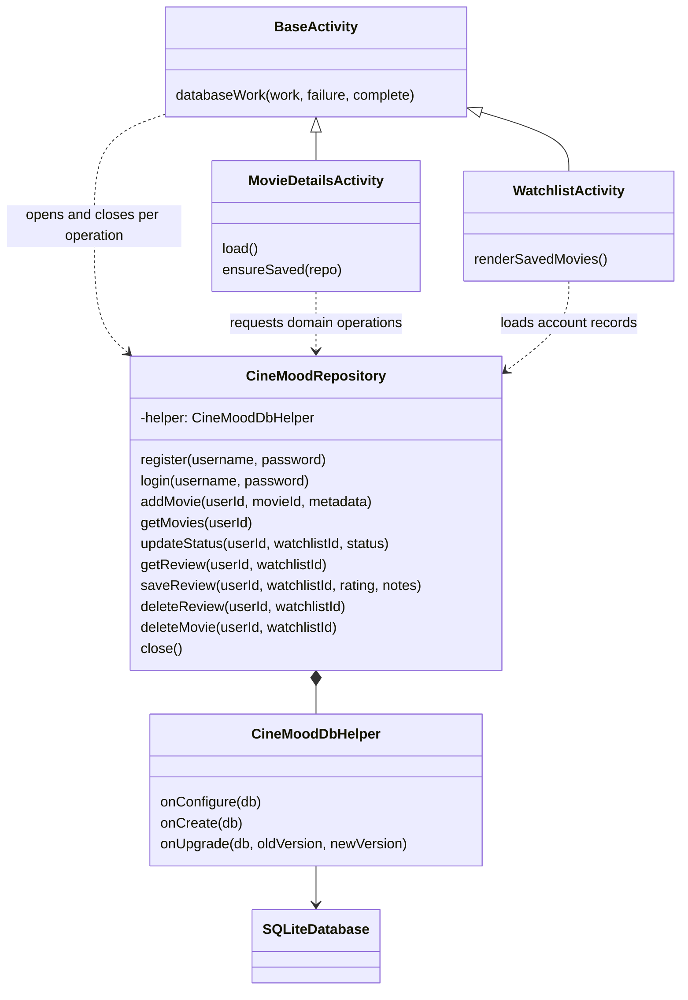

# CineMood Repository pattern

CS0053, November 25, 2026. This is an explanation of the pattern already used in the application, not a new feature or a claim that CineMood implements an entire enterprise architecture.

## Definition and problem

A repository offers a data-access boundary so callers use domain-oriented operations rather than repeating storage queries. The original pattern description emphasizes separating domain access from data mapping and concentrating query construction: [Fowler’s Repository catalog](https://martinfowler.com/eaaCatalog/repository.html), consulted November 25, 2026.

CineMood needs the same account ownership, duplicate prevention and review rules in multiple screen flows. Duplicating SQL in each Activity would make it easy to forget an owner predicate or update related records inconsistently. The concrete `CineMoodRepository` centralizes these operations over SQLiteOpenHelper.

This implementation is a pragmatic local repository/data-access layer. It is not Fowler’s complete collection/query-specification architecture: no repository interface, separate domain service or interchangeable SQL/cloud backend exists. Its benefit here is a consistent account-scoped persistence boundary.

## Actual design



Source: [repository](../app/src/main/java/com/example/cinemood/data/CineMoodRepository.kt), [helper](../app/src/main/java/com/example/cinemood/data/CineMoodDbHelper.kt), [shared worker](../app/src/main/java/com/example/cinemood/BaseActivity.kt), [details screen](../app/src/main/java/com/example/cinemood/MovieDetailsActivity.kt).

## Source walkthrough: save a personal review

1. MovieDetailsActivity reads the rating/notes and rejects ratings outside 1–5. It captures the current session user ID; background work receives a repository instance through BaseActivity.databaseWork.
2. `ensureSaved(repo)` finds an existing entry or saves its metadata. This screen operation precedes review save; the entire add-and-review flow is not one cross-method transaction.
3. `saveReview(userId, watchlistId, rating, notes)` checks rating again and begins a SQLite transaction.
4. A parameterized ownership query checks the watchlist ID belongs to that user. If it does not, return false; finally still ends the transaction without marking success.
5. `getReview` joins reviews to watchlist with the same owner predicate. The repository inserts a new review or updates the existing row.
6. It marks the transaction successful, returns true and ends the transaction. The background scope closes the helper; the UI callback refreshes the screen.

An exact method from the repository illustrates the owner-scoped deletion boundary:

```kotlin
fun deleteMovie(userId: Long, watchlistId: Long): Boolean = helper.writableDatabase.delete(
    "watchlist", "user_id = ? AND watchlist_id = ?", arrayOf(userId.toString(), watchlistId.toString())) == 1
```

The Activity requests removal without assembling this predicate. Foreign-key behavior in CineMoodDbHelper then removes the linked review. Review deletion is a separate operation with its own ownership check, preserving the movie.

## Why this pattern fits better than the compared alternatives

| Option | What it addresses | Fit/tradeoff for CineMood |
| --- | --- | --- |
| Repository (implemented) | A coherent boundary for data operations and repeated persistence rules. | Addresses the actual need to reuse owner-scoped CRUD and transactions. |
| Singleton database access | Controls the lifetime/number of shared instances. | A different problem: a single helper would not itself centralize account predicates or review validation. Repository instances here are scoped and closed, not a global Singleton. |
| Active Record | Makes persisted model objects responsible for saving/querying themselves. | Would put SQLite concerns into Movie/record objects and require broader changes to existing navigation/data objects. The current repository retains plain records. |
| SQL directly in Activities | Minimizes initial abstraction. | Repeats validation/queries across screens and couples view code to schema details. |

These are tradeoff comparisons, not claims that alternatives can never work. No new pattern was added merely to satisfy the rubric. PosterLoader and PasswordPolicy are Kotlin objects, but they are not the principal evidence for the Repository requirement.

## Behavior evidence

[DatabaseIntegrationTest](../app/src/androidTest/java/com/example/cinemood/data/DatabaseIntegrationTest.kt) constructs repositories with a dedicated test database and verifies actual SQLite behavior:

| Pattern-dependent behavior | Test method |
| --- | --- |
| Shared account-scoped access rules | `accountsCannotAccessEachOthersRecords` |
| Reusable create/read/update/delete review operations | `reviewCreateReadUpdateDelete` |
| Data consistency after movie removal | `deleteMovieCascadesReview` |
| Invalid values rejected at data boundary | `invalidRatingRejected`, `statusValidationAndUpdate` |
| Duplicate-save handling | `movieCreateReadAndDuplicate` |
| Persisted data survives repository/database reopening | `dataSurvivesDatabaseReopen` |

See [executed API/design verification](API_DESIGN_VERIFICATION.md) for the fresh targeted run. These are integration tests, not mocked repository-interface tests. Source links and method names make the pattern independently inspectable.

## Presentation walkthrough

Open MovieDetailsActivity’s review handler, then BaseActivity.databaseWork, then repository saveReview. Explain the user ID/transaction, show the helper’s foreign key, and run the ownership/cascade tests. The diagram is an equivalent design illustration and should match the source students demonstrate. Mark and Stephen should review the explanation before merging; original database work remains credited to Rasheed.
