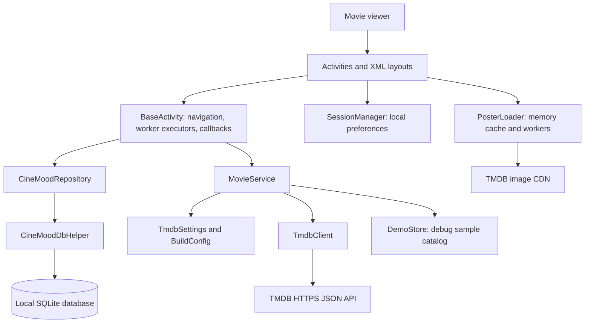
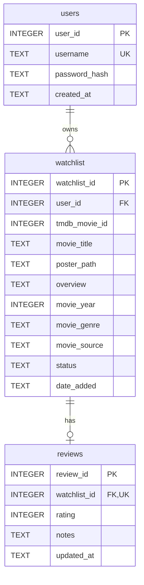

# CineMood technical design

CS0053 review draft, November 25, 2026. Baseline `7ff352d`; branch `docs/api-and-design`. Implementation: native Kotlin Activities/XML, SQLite and TMDB. This describes the actual application; it does not claim a Compose, MVVM, Room, Retrofit or hosted-backend architecture.

## Components and boundaries



| Module | Actual responsibility | Main source |
| --- | --- | --- |
| Screens | Login/registration, dashboard, search, moods, movie details, watchlist, journal and About/developer settings. Gather inputs, render outputs and launch intents. | `*Activity.kt` under app main package |
| Shared screen infrastructure | Apply window insets, keep Back accessible, enforce session gate, execute DB/network work and return callbacks to UI thread. | [BaseActivity](../app/src/main/java/com/example/cinemood/BaseActivity.kt) |
| Movie data | Immutable Movie with JSON navigation payload; MovieRecord/ReviewRecord describe database output. | [Movie](../app/src/main/java/com/example/cinemood/Movie.kt), repository |
| Local data boundary | Validate/register/login, account-scoped CRUD, hash passwords, transact review updates. | [CineMoodRepository](../app/src/main/java/com/example/cinemood/data/CineMoodRepository.kt) |
| Schema | Configure foreign keys, create v2 tables and upgrade v1. | [CineMoodDbHelper](../app/src/main/java/com/example/cinemood/data/CineMoodDbHelper.kt) |
| Session | Persist local user ID/name and clear session on logout. | [SessionManager](../app/src/main/java/com/example/cinemood/data/SessionManager.kt) |
| Discovery | Choose debug sample/live path; call API; parse movies; map mood vocabulary. | [TmdbClient/MovieService](../app/src/main/java/com/example/cinemood/network/TmdbClient.kt), [MoodSearch](../app/src/main/java/com/example/cinemood/MoodSearch.kt) |
| Images | Validate poster path, load on workers, retain bounded memory cache, fall back to reel. | [PosterLoader](../app/src/main/java/com/example/cinemood/network/PosterLoader.kt) |

## Discovery-to-watchlist data flow

```mermaid
sequenceDiagram
    actor User
    participant Screen as Search/Mood Activity
    participant Base as BaseActivity workers
    participant Service as MovieService/TmdbClient
    participant TMDB
    participant Details as MovieDetailsActivity
    participant Repo as CineMoodRepository
    participant DB as SQLite
    User->>Screen: Submit title or choose mood
    Screen->>Base: movieWork
    Base->>Service: search/discover
    Service->>TMDB: GET with bearer header
    TMDB-->>Service: JSON response or error
    Service-->>Base: List of Movie or exception
    Base-->>Screen: UI callback, stale-version guard
    User->>Screen: Open returned movie
    Screen->>Details: Movie JSON intent payload
    Note over Details: No separate TMDB details request
    User->>Details: Save movie / review
    Details->>Base: databaseWork
    Base->>Repo: Account-scoped operation
    Repo->>DB: Parameterized SQL / transaction
    DB-->>Repo: Result
    Repo-->>Base: ID / Boolean / records
    Base-->>Details: Render completion or error
```

MovieDetails reconstructs the passed Movie; saved entries reconstruct it from local metadata. This avoids needing live discovery to reopen saved metadata. An image can still require CDN access because the poster cache is memory-only. Local accounts do not correspond to TMDB identities.

## Database relationships



- Username is nonnull, unique with NOCASE collation. Usernames are trimmed at the repository boundary; passwords are not silently trimmed.
- `(user_id, tmdb_movie_id)` is composite unique. Status defaults to PLANNED and is constrained to PLANNED/WATCHED.
- Review watchlist_id is unique, so an entry has at most one review; rating is constrained to 1–5. Notes are optional.
- Foreign keys are enabled in onConfigure. Removing a saved movie cascades to its review. Deleting a review alone preserves the saved movie. User deletion would cascade in the schema, but no account-deletion UI is implemented.
- Fresh schema v2 defaults movie source to TMDB. Upgrading v1 adds year, genre and a LEGACY source default; known original sample IDs/titles are remapped to negative IDs and SAMPLE. Other legacy entries remain LEGACY, not invented live metadata. IDs/review links are retained.

## Threads, lifecycle and resource handling

BaseActivity uses one database worker and three network workers. Each databaseWork opens a repository scoped with `use`, closing the helper afterward. UI callbacks check that the Activity is neither finishing nor destroyed. This is a concrete executor/callback design, not coroutine structured concurrency; in-flight requests are not canceled on every screen change.

Search/Mood increment requestVersion to ignore older results; Mood removes pending debounce callbacks on destruction. Form/mood/filter selections are saved where implemented; this does not constitute automatic persistence of every temporary screen state. PosterLoader has its own two-worker pool, memory limit and tag check. HTTP streams/connections close on success/error. See [API documentation](API_DOCUMENTATION.md) for exact timeout/error behavior.

## Security and validation

Repository registration uses a 16-byte random salt, 120,000 PBKDF2 iterations and 256-bit output. API 26+ uses HMAC-SHA256; API 24–25 uses HMAC-SHA1 compatibility. Verification also reads original three-part SHA256 hashes and uses MessageDigest.isEqual. PasswordPolicy requires 8+ characters without whitespace. This is local password hashing, not encrypted SQLite or cloud authentication.

Data operations bind SQL arguments and enforce user ownership. Review save checks ownership inside a transaction before insert/update. Session preferences are local, with no server-authentication protocol. Backup is disabled and explicit data-extraction exclusions exist; a full device-transfer audit is not claimed. Token properties/signing keys are ignored by Git, but build tokens remain extractable from APKs. Follow [setup](SETUP.md) and [SRS constraints](SRS.md).

## Decisions, tradeoffs and maintenance

| Decision | Reason in this project | Tradeoff |
| --- | --- | --- |
| Preserve Activities/XML | Fits the approved working app and existing student implementation. | No Compose previews; more manual view wiring. |
| Concrete repository over SQLiteOpenHelper | Centralizes validation, ownership, queries and review transactions. | Activities still know a concrete class; not a full replaceable data interface. |
| Save metadata with watchlist | Offline journal and reduced dependency on repeat live requests. | Metadata can become stale; no automatic refresh policy. |
| Rule-based moods | Explainable genre selection appropriate to scope. | Not personalized; different moods can overlap. |
| Build-configured TMDB access | Release users do not manage tokens. | Extractable credential; future public deployment needs a revised architecture. |
| Optional connection factory | Deterministic tests execute real HTTP branches. | Small testing seam; it does not add end-user configuration. |

The Repository pattern is explained with actual methods, alternatives and tests in [DESIGN_PATTERNS.md](DESIGN_PATTERNS.md). Verification and current limits are in [API_DESIGN_VERIFICATION.md](API_DESIGN_VERIFICATION.md).

## Contribution and review

Original contributors remain credited: Mark — discovery/API; Rasheed L. Librorania — accounts/database; Stephen Josh Canete — watchlist/integration. CS0053 team: Stephen and Mark. Codex prepared this source-based draft and test support at Stephen’s request; Mark must verify API claims and both students must understand the submitted design. No contributor’s original work is reassigned by this document.
