# CineMood user manual

CS0053 — Stephen Josh Canete and Mark Jayson D. Cadano. Prepared November 25, 2026. App version 1.0 (code 1). Review edition: final signed-APK acceptance and Mark’s independent setup results are pending. Original CS0011 accounts/database contribution: Rasheed L. Librorania.

CineMood helps you discover a movie by title or mood, save a watchlist and keep personal viewing status, ratings and notes. It does not play/stream movies. Accounts and saved records belong to this installation, with no cloud sync or password-reset service.

The screenshots show the current **debug build** on Pixel 10a / Android 17 (API 37.1), captured from real screens using a temporary account and live TMDB data. Consequently, Developer movie settings appears where the classroom release shows About CineMood. These figures are not presented as screenshots of a newly signed release APK. Movie results/posters can change. See [test report](TEST_REPORT.md) and [capture provenance](evidence/final-review/SCREENSHOTS.md).

## 1. Install and launch

**Purpose:** Install the classroom application on a compatible Android device.

**Prerequisites:** Android 7.0/API 24 or later; the team’s final signed APK from the approved submission/release; internet for live discovery and uncached posters. The final CS0053 artifact is not yet designated by this manual. Developers should use [SETUP.md](SETUP.md) to build from source instead.

**Procedure:**
1. Obtain the signed CineMood APK from your instructor/team’s agreed location.
2. Open it with Android’s package installer. If prompted, permit installation from that specific delivery app only if you trust the supplied file.
3. Install, then open CineMood from the launcher.
4. Create an account or sign in. Movie access is configured by the team before building a release; release users do not supply a TMDB token.

**Expected result:** CineMood opens at login, or the dashboard when a valid local session already exists.

**Screenshot:** [Login](evidence/final-review/01-login.png).

**Troubleshooting:** An unsupported Android version cannot install. A differently signed APK cannot update the same application ID. Ask the team for the correct build; uninstalling or clearing storage deletes local accounts, watchlists and reviews. Do not remove an existing installation containing needed records merely to bypass a signing conflict.

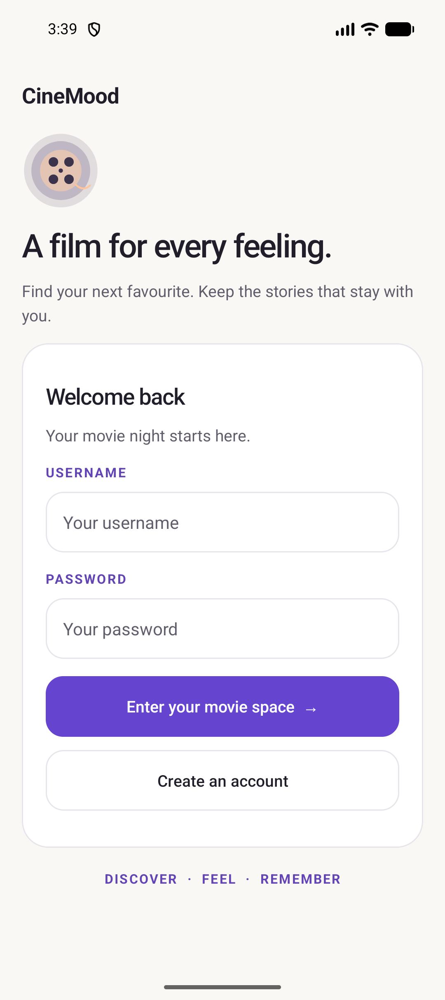

## 2. Create an account

**Purpose:** Create a local identity to keep personal movie records separate from other users.

**Prerequisites:** App installed; username not already used on this installation.

**Procedure:**
1. On login, tap **Create an account**.
2. Enter a nonblank username.
3. Enter a password of at least eight characters, without spaces, tabs or other whitespace.
4. Re-enter the same password in the confirmation field. Eye controls let you inspect password entry; avoid exposing it while screen-sharing.
5. Tap **Start my movie journey** and follow the success message back to sign-in.

**Expected result:** A local account is created. Duplicate usernames are rejected without regard to letter case.

**Screenshot:** Registration form below.

**Troubleshooting:** Read the field error for blank username, short/whitespace password or mismatch. Choose another username when one already exists. An account on another phone is not automatically available here.

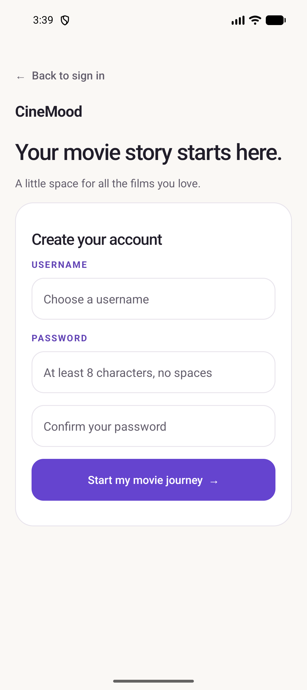

## 3. Sign in, navigate and log out

**Purpose:** Open your personal movie space and move between features.

**Prerequisites:** A local account on this device.

**Procedure:**
1. Enter your username/password and tap **Enter your movie space**.
2. From the dashboard choose **Find my mood**, **Search the collection** or **Open my watchlist**.
3. Use the Back control near the top of feature screens or Android Back to return.
4. Scroll the dashboard if necessary to find **Log out**. Logging out preserves saved records.

**Expected result:** Successful sign-in opens your dashboard; invalid credentials show an error. Logout returns to sign-in, and Back cannot reopen authenticated screens without a session.

**Screenshot:** Dashboard below; the example username is disposable.

**Troubleshooting:** Check credentials carefully. There is no cloud recovery service. Returning to login after clearing app storage is expected because local accounts were removed.

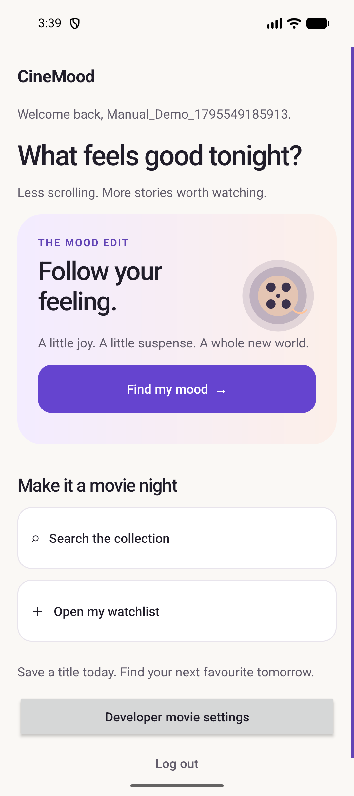

## 4. Search movies and open details

**Purpose:** Find live movie information and a poster.

**Prerequisites:** Signed release with team-configured movie access and a working internet connection. Debug screenshots use the same live API; debug sample mode is separately labeled when selected.

**Procedure:**
1. Open **Search the collection**.
2. Enter a movie title, such as Interstellar, and tap **Find a film** or the keyboard’s search action.
3. Review the returned titles, years, genres and available posters.
4. Tap a movie row to open its details and overview.

**Expected result:** Results are labeled TMDB. No matches show an empty message; failures show a retry/connection message. The current implementation displays only the first page of results. Details use information from the returned/saved movie rather than a separate details API call.

**Screenshot:** Live results below; [movie details](evidence/final-review/07-details.png).

**Troubleshooting:** Submit a title rather than a blank explicit search. Try another title if no matches appear. A reel placeholder means a poster is absent or could not load; it does not prevent opening the movie. If movie access is unavailable, contact the team rather than entering credentials into a release screen.

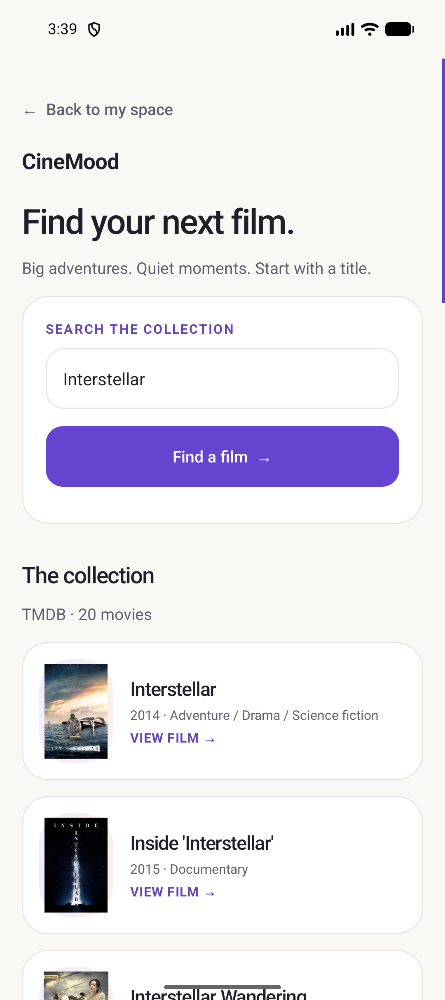

## 5. Discover by mood

**Purpose:** Browse movie suggestions using explainable genre rules.

**Prerequisites:** Internet and configured movie access for live results.

**Procedure:**
1. Open **Find my mood**.
2. Choose Upbeat, Smitten, Amped, Spooked, Intrigued, Chill or Wistful, or type an everyday feeling in the mood search field.
3. Select **Anything**/clear the mood to browse without a selected mood.
4. Tap a recommendation to open details.

**Expected result:** The selected mood and heading update with recommendations. Recognized typed phrases can match multiple moods; unknown feelings receive a clear no-match message. Different moods can share some movies. These rules are not machine learning or mental-health advice.

**Screenshot:** Chill recommendations below.

**Troubleshooting:** Try a listed label or common phrase if the app cannot recognize a feeling. On service errors, check connectivity and try again; the app does not silently replace live failures with sample movies.

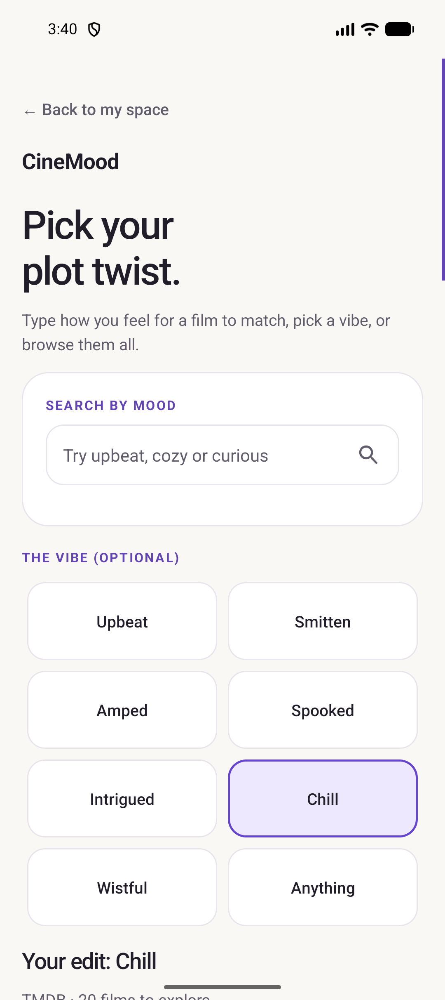

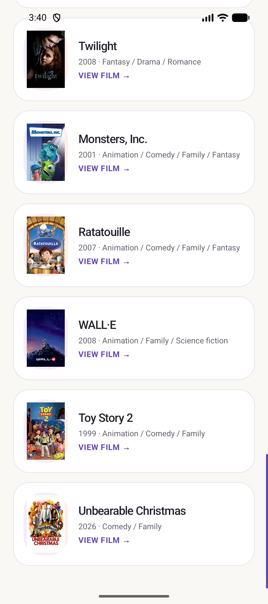

## 6. Save and reopen a movie

**Purpose:** Keep a movie in your personal watchlist.

**Prerequisites:** Signed in; a movie open from Search or Mood.

**Procedure:**
1. Open movie details.
2. Tap **Add to watchlist**.
3. Return to the dashboard and open **Open my watchlist**.
4. Tap the saved movie to reopen it.

**Expected result:** The movie appears once in your account’s collection. Repeated saves do not create duplicates. Saved metadata can be reopened offline; a poster may still require internet because images are cached only in memory.

**Screenshot:** Details below; the example is already saved, so its Add control reflects that state.

**Troubleshooting:** Confirm the same local account is signed in. Another account’s collection is intentionally separate. A blank collection after uninstall/clear-storage is expected data loss, not cloud sync failure.

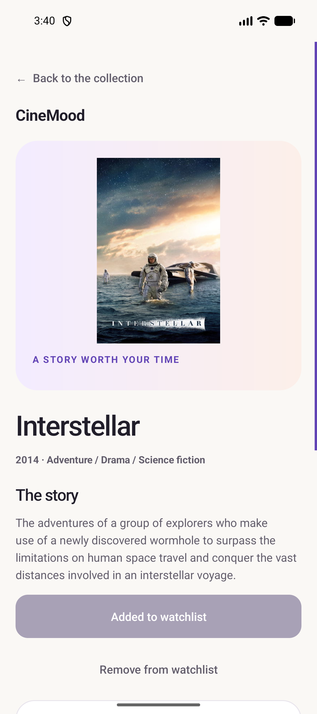

## 7. Search, filter and sort the watchlist

**Purpose:** Find and organize saved movies.

**Prerequisites:** Signed in; save movies first for a populated list.

**Procedure:**
1. Open the watchlist.
2. Enter part of a title in the watchlist search field.
3. Choose **All movies**, **To watch** or **Watched**.
4. Choose **Newest saved**, **Title A–Z** or **Release year** (newest release year first).
5. Clear the title/status filter to see all saved entries again.

**Expected result:** Matching records update according to the selected controls. An empty collection and a search with no matches have distinct messages. No movie is deleted by filtering.

**Screenshot:** Watchlist below.

**Troubleshooting:** If a known movie is missing, clear the search/filter and verify the account. Sorting changes order, not viewing status.

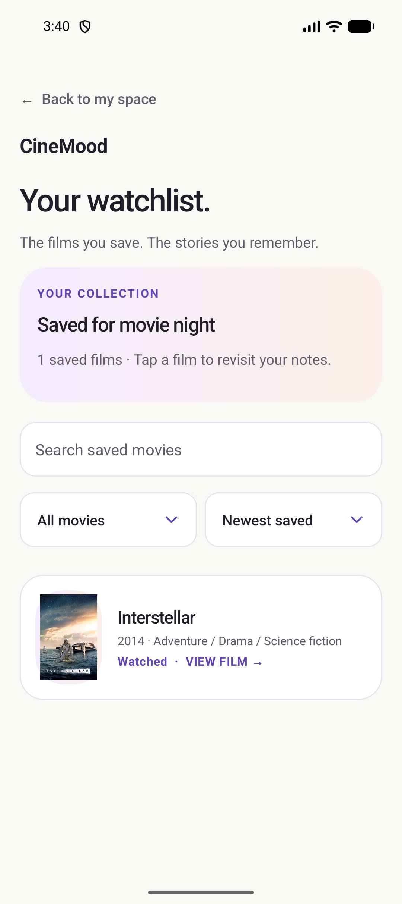

## 8. Watched status, rating and notes

**Purpose:** Keep a viewing journal within each saved movie.

**Prerequisites:** Signed in; movie details open. Setting status or saving a review can first save the movie automatically if it is not already in the watchlist.

**Procedure:**
1. Scroll to **Your viewing journal** in movie details.
2. Toggle **I have watched this film**. The status saves immediately.
3. Choose a rating from one to five stars and enter optional notes.
4. Tap the rating/notes save button.
5. Reopen the movie to verify your saved information.

**Expected result:** Status, rating and notes remain associated with this account and movie. There is one editable personal review per saved entry; the journal is part of details, not a separate dashboard destination.

**Screenshot:** Review controls below; values were saved for the temporary documentation account.

**Troubleshooting:** Select at least one star before saving. Merely typing notes does not save them; use the save button. Busy controls become available after database work finishes.

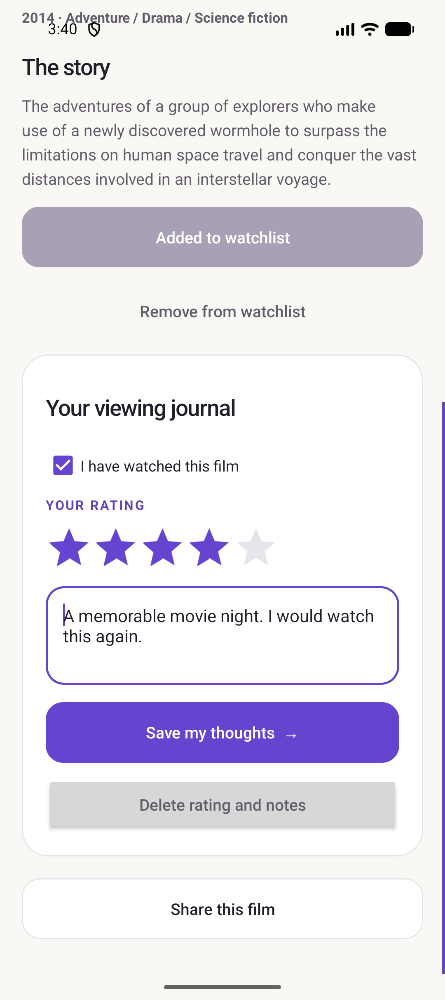

## 9. Delete a review or remove a movie

**Purpose:** Remove personal review content separately, or remove the saved movie entirely.

**Prerequisites:** Saved movie open in your account.

**Procedure:**
1. To delete only rating/notes, choose **Delete rating and notes**, then confirm Delete. Cancel preserves them.
2. To remove the whole saved entry, choose **Remove from watchlist** and read the confirmation.
3. Choose Cancel to preserve it, or Remove to delete the movie and its linked rating/notes.

**Expected result:** Deleting a review keeps the movie; removing the movie removes its review too. These actions have no in-app undo after confirmation.

**Screenshot:** Removal confirmation below.

**Troubleshooting:** If you removed a movie accidentally, you can search/save it again, but previously deleted personal notes/ratings are not restored automatically.

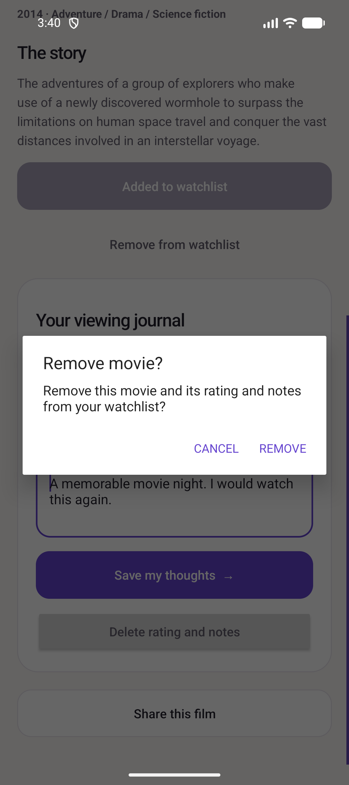

## 10. Share a movie

**Purpose:** Prepare a title/year recommendation for another app.

**Prerequisites:** Movie details open; compatible sharing app installed for delivery.

**Procedure:**
1. Tap **Share this film** in movie details.
2. Choose a destination from Android’s share sheet.
3. Review the prepared text and complete or cancel sending in the chosen app.

**Expected result:** CineMood prepares the title and year. It does not send a message automatically or share private journal notes through this action.

**Screenshot:** The action is on the same details/review screen shown above; the system share sheet varies by installed apps and was not newly captured for this manual.

**Troubleshooting:** Install/select a compatible app if no target is available. CineMood handles the absence of a sharing app, but final delivery belongs to the selected app. External-message sending was not tested during preparation.

## 11. About and TMDB attribution

**Purpose:** Identify the source of movie information and images.

**Prerequisites:** Signed in to reach the dashboard destination.

**Procedure:**
1. On the classroom release dashboard, open **About CineMood**.
2. Read About and credits, the official TMDB logo, required attribution notice and website.
3. Use Back to return.

**Expected result:** The official logo keeps its approved gradient/aspect ratio and appears with the attribution notice. Release users see no token-entry controls. The screenshot is the shared credits section of a debug build, so developer controls may appear above it; final signed-release verification is still pending.

**Screenshot:** Actual updated credits below.

**Troubleshooting:** A live-access problem should be reported to the team with the visible error and app version, never a token or password. Developers can use [TMDB_BUILD_SETUP.md](../TMDB_BUILD_SETUP.md); end users should not need that setup.

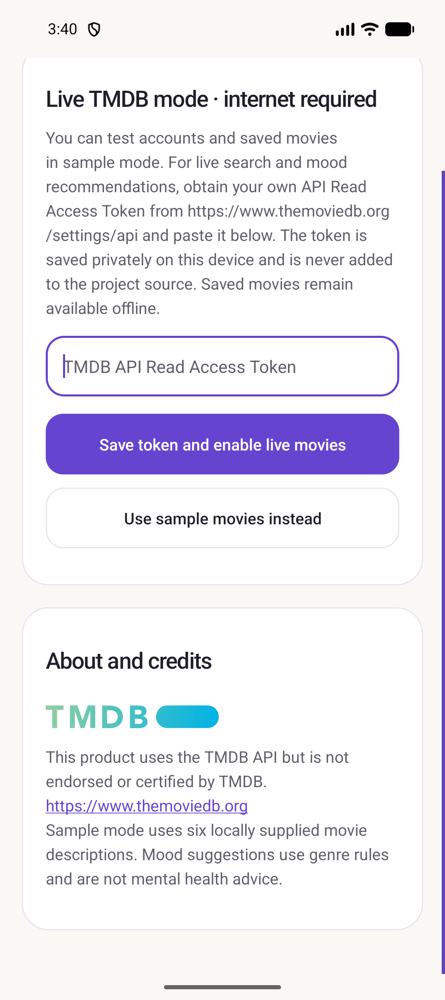

## 12. Common problems and privacy

| Problem | Action |
| --- | --- |
| Cannot connect / timeout | Check device internet and retry; local watchlist data remains available. |
| Service is busy | Wait and retry normally; avoid repeatedly submitting requests. |
| Movie discovery unavailable | Contact the team; a rotated build credential may require an updated APK. |
| Unexpected sample label | This is a debug-development setting, not a successful live API check. Ask the team for the designated release. |
| Poster missing offline | Reconnect if needed; there is no persistent image-download feature. |
| Password/account lost | No cloud reset/sync exists. Do not clear storage if saved local data is needed. |
| App installation conflict | Obtain the correctly signed update; use a separate emulator for debug testing. |

Local records are not a shared online account service. Uninstalling, clearing storage or changing devices does not retain them automatically. Avoid placing sensitive information in notes. Keep private build credentials and signing keys outside Git and screenshots.

## References and maintenance

Movie data/images and logo: [TMDB](https://www.themoviedb.org/), [official attribution guidance](https://www.themoviedb.org/about/logos-attribution). Technical behavior: [API manual](API_DOCUMENTATION.md), [design](TECHNICAL_DESIGN.md), [test report](TEST_REPORT.md). Screenshots are generated by [DocumentationCaptureTest](../app/src/androidTest/java/com/example/cinemood/DocumentationCaptureTest.kt) using real app screens and disposable data. Codex assisted with this manual; Stephen and Mark must review accuracy and update figures after material UI changes.
