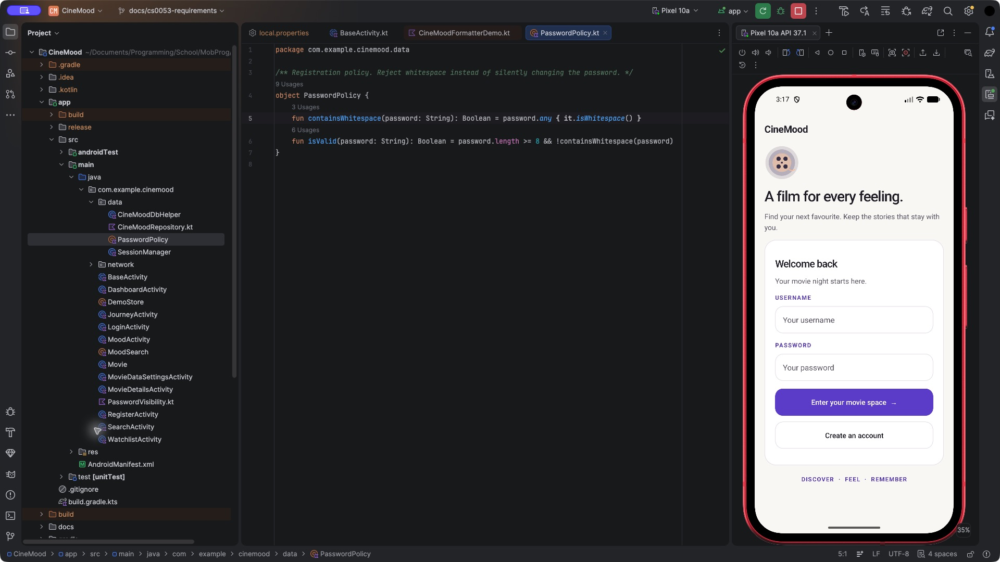
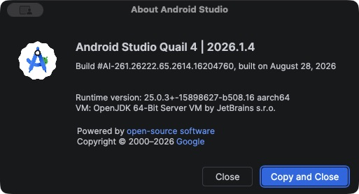
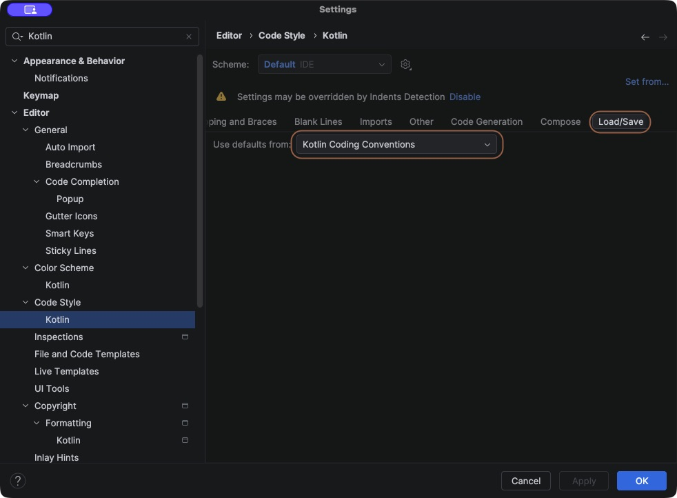
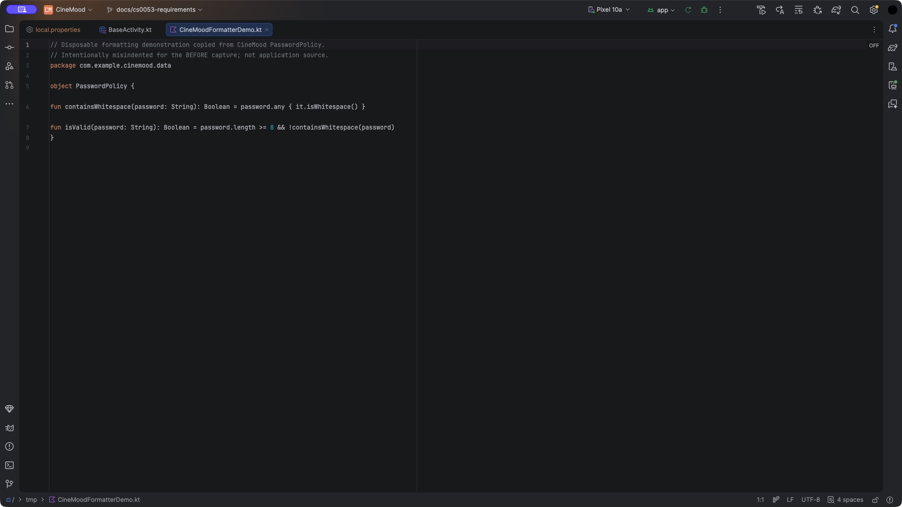
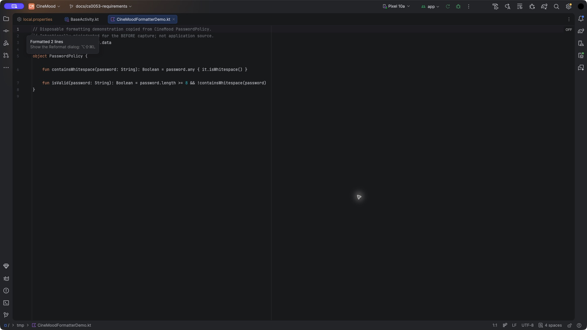
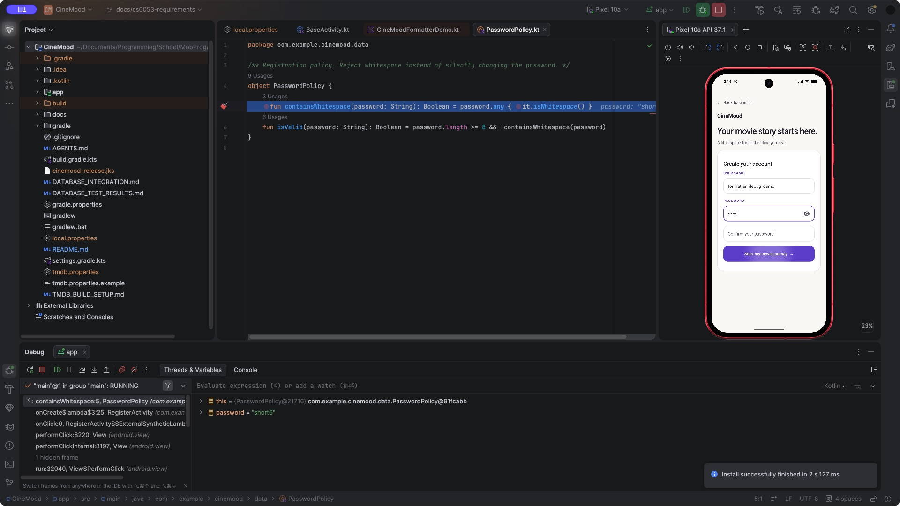
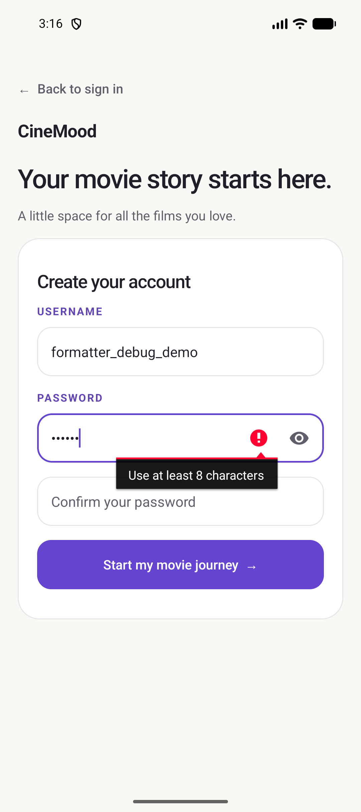
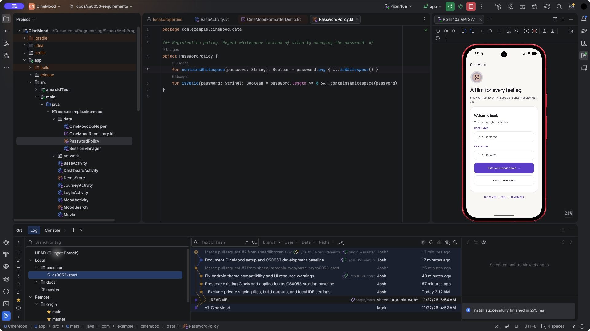

# Android Studio screenshot evidence

Captured November 25, 2026 (Asia/Manila), branch `docs/cs0053-requirements`, application baseline `7741433`. Operator: Codex, at Stephen’s request. Platform: Android Studio Quail 4 / 2026.1.4, Pixel 10a API 37.1.

These are real IDE/emulator captures. Empty white padding from the native window-capture output was cropped from the IDE screenshots; screenshot content was not recreated or annotated. The debugger input is disposable test text, not a saved user credential. No live API token or signing password is shown.

## 1. Environment and directory structure

Shows the `data` and `network` organization, screen classes, tests/resources, syntax-highlighted password-policy source and login screen in Running Devices. Inline usage counts also demonstrate Kotlin code insight. Private configuration file contents were kept closed.

## 2. IDE version and runtime

About Android Studio identifies Quail 4 / 2026.1.4 and the JetBrains OpenJDK runtime. This is the IDE runtime; the Gradle/JDK setup is separately explained in the setup guide.

## 3. Formatter configuration

Settings → Editor → Code Style → Kotlin → Load/Save shows Default IDE scheme and Kotlin Coding Conventions. Settings were inspected, not changed. Indents Detection may override settings, as the dialog notes.

## 4. Formatter before

The temporary `/tmp/CineMoodFormatterDemo.kt` file copies the existing PasswordPolicy logic and intentionally omits function indentation. It is an explicitly labeled demonstration file outside application sources, not an existing defect in the baseline.

## 5. Formatter after

Reformat Code (`⌥⌘L`) indented the two functions; the IDE reports “Formatted 2 lines”. The operation required confirming editing of this single non-project file. No project code was modified and no broad file-protection preference was changed.

## 6. Debugger breakpoint, stack and variable

A temporary method breakpoint at `PasswordPolicy.containsWhitespace`, line 5, paused registration validation after submitting the disposable username `formatter_debug_demo` and a short test password. The call stack includes RegisterActivity; Variables shows `password = "short6"`. This intentionally disposable value is shown only to explain validation, not as a real credential. Method breakpoints can slow debugging; the IDE issued a warning. This is a method-entry demonstration, not a performance measurement or a code fix.

## 7. Resumed validation result

After resuming, the app showed “Use at least 8 characters”. The password did not meet registration requirements, so no account or database record was created. The temporary breakpoint was removed, the debug session stopped, and the normal app session relaunched at login. Local user data was not cleared.

## 8. Git workflow in Android Studio

The graph shows the baseline and setup work, including the merge subjects for PR #1 and PR #2, branch labels and authors. These are genuine existing commits. Remote approval discussions must still be retained on GitHub; a local graph alone does not establish who reviewed a pull request.

## Review limits

The captures demonstrate environment setup, formatting and debugging plus Git/source insight. Lint and test output from the preceding verification are linked in [DEVELOPMENT_TOOLS.md](../../DEVELOPMENT_TOOLS.md). No new full instrumentation suite, Logcat defect investigation, independent setup or final release acceptance test was performed during this capture session. Stephen reports the instructor approved Android Studio equivalents; the original approval record is not attached here. Student reflections and Mark’s review must reflect their actual personal work.
